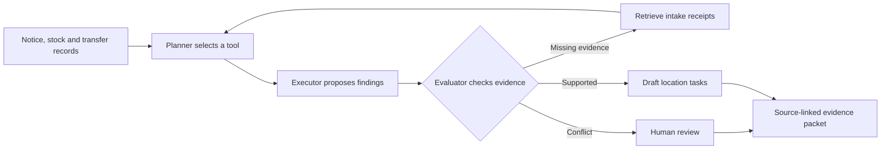

# PantryTrace

[](https://github.com/Pradhyut21/pantrytrace/actions/workflows/check.yml)

**Every recall decision needs a receipt.**

PantryTrace helps food-bank coordinators investigate recalled stock when donation receipts, inventory sheets and transfer records disagree. It retrieves the missing evidence, checks the proposed finding and produces an internal task draft with its sources attached.

[Watch the 1:56 walkthrough](https://drive.google.com/file/d/1A3MebeBEs_cJHzJBYgj1wZ6Pcby7npV8/view?usp=drivesdk) · [Try the demo](docs/DEMO.md) · [View the pitch deck](docs/pitch/pantrytrace-pitch.pdf) · [Read the architecture](docs/architecture.md)


> **Preparation prototype, 19-20 October 2026.** All operational data is synthetic. The local investigation workflow and Meterless H-MEM integration have been exercised; live Zetaris, Nemotron and actual Cursor development proof remain pending. See [submission readiness](docs/SUBMISSION_READINESS.md) and the [pre-existing work declaration](PREEXISTING.md).

## Run locally

Python **3.11+** is sufficient for the workbench. No API key or Python package installation is required.

```sh
git clone https://github.com/Pradhyut21/pantrytrace.git
cd pantrytrace
python -m pantrytrace serve
```

Open **http://127.0.0.1:8765**. Keep **Missing lot - retrieve intake record** selected, click **Investigate recall**, inspect the evidence and trace, then choose **Export evidence packet**. Use `python3` if that is your Python command. The server binds to loopback.

## Follow the evidence

A supplier alias and an incomplete stock line are insufficient to establish a recalled lot. PantryTrace's evaluator rejects that unsupported conclusion. Its planner retrieves the matching intake receipt, then the executor revises the finding. Conflicting evidence stays in human review.



The current controller is **deterministic**. These roles are bounded software components, with inspectable tool choices and retries. A model adapter is prepared separately; the prototype does not claim LLM-directed investigation or a verified model run.

| Case | Observable behavior |
| --- | --- |
| Missing lot (`ambiguous`) | A second pass retrieves a receipt, resolves 30 on-hand units and retains context for six transferred units. |
| Exact lot (`exact`) | Structured product and lot identifiers distinguish affected stock from documented exclusions. |
| Conflicting records (`conflict`) | Contradictory receipts leave 18 units in human review. |
| Similar product (`out_of_scope`) | A distinct identifier stays outside this recall; an unidentified carton remains unresolved. |

Supplier notes are untrusted inputs. Proposed quarantine and transfer tasks require a person to act; the application sends no notifications and changes no inventory. **Outside this recall** describes the scope of the supplied notice, never a food-safety clearance.

## Reproduce the evidence

```sh
python -m unittest discover -s tests -v
python -m pantrytrace evaluate
python scripts/verify_provenance.py
python -m pantrytrace demo --scenario ambiguous --output artifacts/ambiguous.json --packet artifacts/action-packet.json
```

The checked-in [evaluation](artifacts/evaluation.json) covers **nine authored synthetic development items** across four cases:

| Method | Correct fixture decisions |
| --- | --- |
| Inventory-only exact-identifier baseline | 8 / 9 |
| Evidence retrieval and evaluation loop | 9 / 9 |

These are development regression results, **not a held-out benchmark or a real-world accuracy estimate**. The current scope supports one product per notice, explicit alphanumeric lot tokens and one outgoing transfer hop. Operator validation and broader evaluation are still needed. See [validation](docs/validation.md) and [fixture provenance](data/PROVENANCE.md).

## Sponsor integration status

| Technology | Prepared implementation | Verified boundary |
| --- | --- | --- |
| **Meterless** | Pinned official H-MEM reference, with remember/recall, feedback and audit bridge. | Real local persistence, cross-process retrieval and audit exercised. No remote model call is implied. |
| **Zetaris** | Read-only REST adapter, table allowlist and connected investigation runner. | Contract tests pass; live queries and federation proof are pending. |
| **NVIDIA Nemotron** | Explicit model-critique adapter. | No authenticated Nemotron inference run has been verified. |
| **Cursor** | Project rules and eligible-window build plan. | Actual Cursor development remains pending; this preparation used Codex. |

To exercise the optional local Meterless path, install Node.js and run:

```sh
npm ci
python -m pantrytrace sponsor-smoke
python -m pantrytrace demo --scenario ambiguous --memory
```

The [smoke receipt](artifacts/meterless-smoke.json) records the tested local scope. The web workbench remains in fixture mode; use the CLI commands above for memory verification. Real Zetaris setup is documented in [CONNECTED.md](docs/CONNECTED.md). Keep credentials in private environment configuration; the application does not automatically load `.env` files.

## Demo and project materials

- [Public Drive walkthrough - 1 minute 56 seconds](https://drive.google.com/file/d/1A3MebeBEs_cJHzJBYgj1wZ6Pcby7npV8/view?usp=drivesdk), also available as a [repository MP4](docs/media/pantrytrace-walkthrough.mp4): the preparation prototype in action.
- [Brag teaser MP4 - 24 seconds](docs/media/pantrytrace-brag.mp4): a short launch-style clip.
- [Pitch deck PDF](docs/pitch/pantrytrace-pitch.pdf) and [editable deck text](docs/pitch-deck.md).
- [Judge demo guide](docs/DEMO.md), [submission copy](docs/submission.md) and [current readiness checklist](docs/SUBMISSION_READINESS.md).
- [Research and competing products](docs/track-research.md), [sponsor research](docs/sponsor-integration-research.md) and [architecture](docs/architecture.md).
- [Media credits](docs/media/MEDIA-CREDITS.md), [data provenance](data/PROVENANCE.md) and [third-party source provenance](vendor/meterless-hmem/NOTICE.md).

The [deliverables index](docs/DELIVERABLES.md) collects the project materials. Editable video compositions, captures and render instructions are in [media-src](media-src/README.md).

Recommended track: **Solving Fragmented Intelligence**, subject to the final challenge statement and organizers' treatment of pre-existing work. Code, data and preparation media from 19-20 October must be declared; eligible-window work and final sponsor evidence must be documented separately. The [release checklist](docs/RELEASE_CHECKLIST.md) tracks the remaining work.

## License

Original application code is [MIT licensed](LICENSE). Vendored Meterless code retains its [Apache-2.0 license](vendor/meterless-hmem/LICENSE) and upstream attribution. Media uses its own [credits and license terms](docs/media/MEDIA-CREDITS.md).
