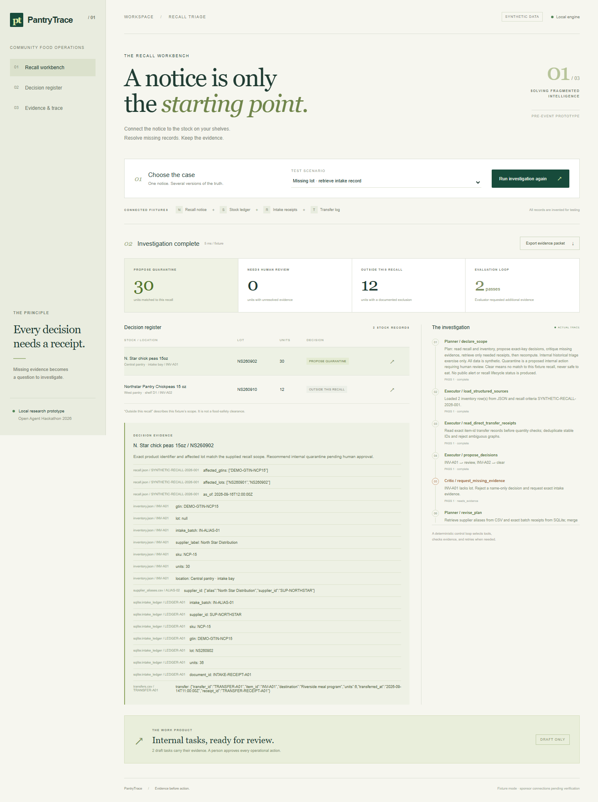
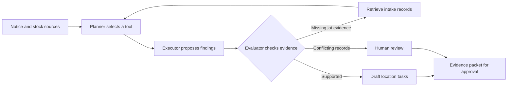

# PantryTrace

**A recall notice does not tell a food bank which shelves, lots, or partner locations need attention. PantryTrace assembles that evidence.**

Recommended hackathon track: **Solving Fragmented Intelligence**.

> Pre-event research prototype, prepared 19 October 2026. All operational records are synthetic. Sponsor status and eligibility disclosures below are part of the project, not optional footnotes. This is internal investigation software, not an official recall alert service or a food-safety determination.

## Run it in 30 seconds

Python 3.11 or later is the only requirement for the fixture workbench. No API key, package install, or model download is needed.

```powershell
cd pantrytrace
python -m pantrytrace serve
```

Open **http://127.0.0.1:8765**. Select **Missing lot**, then **Investigate recall**. Inspect the decision evidence and actual execution trace, then export the draft evidence packet.

Other commands, from the project directory:

```powershell
python -m unittest discover -s tests -v
python -m pantrytrace demo --scenario ambiguous --output artifacts/ambiguous.json --packet artifacts/action-packet.json
python -m pantrytrace evaluate --output artifacts/evaluation.json
python -m pantrytrace doctor
python -m pantrytrace sponsor-smoke
```

The project runs on Windows, macOS, and Linux. Use `python3` where that is your Python command. The development server binds only to loopback.

For real local Meterless memory, install the optional runtime once with `npm ci`, then run `python -m pantrytrace demo --scenario ambiguous --memory`. Prior context is retrieved, fresh source evidence is checked, and the result is persisted and audited in the actual H-MEM engine. Default fixture runs still need only Python.



## The investigation

A donation receipt contains a supplier alias. The stock ledger has no lot number. A later transfer moved part of the stock to another pantry. A name match alone cannot resolve the case.

PantryTrace first proposes a decision using available records. The evaluator rejects unsupported lot conclusions. The planner requests the relevant intake records, rechecks the finding, and either produces evidence-linked internal task drafts or leaves the line unresolved for a person.



The current controller is deterministic. Its agent roles are bounded software components that choose tools, share evidence, critique findings, and retry. It does **not** claim autonomous LLM reasoning. Optional model critique is a separate experimental integration and cannot override deterministic evidence requirements.

## Four cases worth trying

| Case | What it demonstrates |
|---|---|
| `exact` | Direct lot match and documented exclusions |
| `ambiguous` | Missing lot triggers evaluator feedback, additional retrieval, and revision |
| `conflict` | Contradictory intake records preserve uncertainty and require human review |
| `out_of_scope` | Similar product names do not establish recall eligibility |

Fixture supplier notes include an instruction-like attack. They remain untrusted data and cannot change the investigation policy. Quantity and evidence checks support task drafts. No email, stock mutation, quarantine, or partner notification actually occurs.

`clear` in the JSON is an internal compatibility label for **outside this specific recall's demonstrated scope**. The UI uses that full meaning. It never means food is safe or authorizes releasing stock.

## Sponsor technology, with proof boundaries

| Technology | Implementation | What has been established |
|---|---|---|
| Meterless | Vendored official H-MEM reference engine with source commit and Apache-2.0 attribution. Optional local remember/recall/audit/feedback bridge. | A real local engine can be exercised with the sponsor smoke command; see `artifacts/meterless-smoke.json` if generated. Fixture investigations do not silently invoke it. |
| Zetaris | Read-only REST adapter based on the sponsor's official getting-started code, configured table allowlist, bearer API key and organization headers. | Adapter and mocked contract tests. A real assigned instance is still required; no live federation is claimed. |
| NVIDIA | Optional structured critique adapter, configured explicitly. | Code only until a real provider call and useful measured contribution are captured. No GPU acceleration is claimed. |
| Cursor | Cursor project instructions and a concrete eligible-window task plan. | Actual development in Cursor still needs to happen and be documented. These files were prepared in Codex. |

See [sponsor integration research](docs/sponsor-integration-research.md), [architecture](docs/architecture.md), and [the release checklist](docs/RELEASE_CHECKLIST.md). Local fallback and caller-supplied connected records are explicitly distinguished from verified sponsor execution.

## Evaluation and limits

`python -m pantrytrace evaluate` runs the labeled synthetic cases and compares with an inventory-only exact-identifier baseline. The fixtures are small regression examples used during development, **not an independent held-out benchmark**. Report their actual denominators and do not extrapolate to production accuracy or saved lives.

The test suite exercises missing and conflicting evidence, unsupported decisions, adversarial supplier notes, task approval, sponsor response handling, and absence of credentials. Generated run/evaluation packets live in `artifacts/` and can be reproduced from source.

Known limitations include: no real user validation, no real pantry data, no automatic public notice ingestion, limited lot syntax, no OCR, no live Zetaris proof, and no measured deployment impact. Data coverage and recency can be incomplete. Unknowns remain review items.

## Repository map

```text
pantrytrace/          engine, adapters, CLI and local HTTP server
web/                 dependency-free responsive workbench
data/                explicitly synthetic notice, stock and transfer fixtures
tests/               deterministic and provider-boundary regression tests
vendor/              attributed, pinned Meterless H-MEM reference sources
scripts/             optional sponsor setup and verification helpers
artifacts/           reproducible fixture outputs and local engine proof
docs/                research, architecture, eligibility and submission materials
.github/workflows/   repeatable CI checks
```

## Research and provenance

Read [the research brief](docs/track-research.md) for competing products, seven repositories, five papers, the track comparison, and a proposed broader benchmark. Recall management and entity matching already exist. The proposed distinction is the small food-bank workflow: uncertain lots, internal evidence reconciliation, transfer context, and reviewable tasks.

The [FDA enforcement data documentation](https://open.fda.gov/apis/food/enforcement/) says its historical data updates weekly and must not power public alerts or recall lifecycle tracking. This prototype uses invented notices and operational data. A future real-data workflow must preserve original notice URLs, retrieval dates, and operator verification.

## Hackathon eligibility and submission

The [official event page](https://hackathon.genai.works/event/open-agent-hackathon-2026) lists the build opening as **22 October 2026, 00:00 UTC / 05:30 IST**, and the submission cutoff as **27 October, 23:45 UTC / 28 October, 05:15 IST**. Final HackOS announcements control changes.

This entire pre-event snapshot, including code, fixtures, research and media, must be declared. Do not backdate commits or present it as work completed during the build window. See [PREEXISTING.md](PREEXISTING.md) for the component declaration and the new-work plan. Only organizers can confirm how the final entry qualifies.

The submission description and 200–300 word idea text are in [docs/submission.md](docs/submission.md). The 1–4 minute walkthrough and short `brag` clip are separate deliverables. Replace preparation-era footage with real sponsor execution and eligible-window implementation evidence before final submission.

## Publish to GitHub

This package is local. No repository has been created or pushed on your behalf.

Create an empty repository on GitHub, then follow [docs/PUBLISH.md](docs/PUBLISH.md). Review the pre-existing declaration first. Keep API keys in environment variables or an ignored local `.env`; the application does not automatically load `.env` files. Vendored third-party code keeps its original license. The original project code is MIT licensed.
